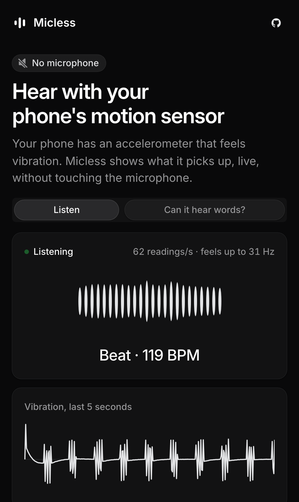
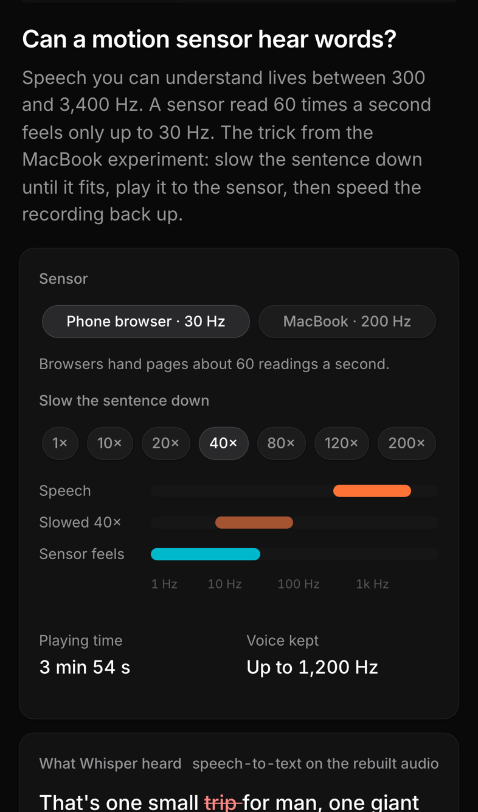

# Micless

Hear with your phone's motion sensor. Micless reads the accelerometer in the browser and shows what it picks up, live: knocks, music on a speaker, a buzz. It never touches the microphone, and nothing leaves the page.

It also answers the question everyone asks next: can a motion sensor hear words?

<p>
  
  
</p>

## Try it

Open the site on your phone and tap **Start listening**. On iPhone, allow motion access when asked. Then:

- Tap the back of the phone twice.
- Lay it on a speaker playing music.
- Press it to your jaw and hum.

The second tab, **Can it hear words?**, works on any device.

## Run it

```sh
npm install
npm run dev     # http://localhost:5173, and on your network for your phone
npm test        # the DSP and the detector, on synthetic signals
npm run build   # static site in dist/
```

A phone only shares its motion sensor with secure pages. To try a dev build on your phone, open it over HTTPS (a tunnel such as `cloudflared tunnel --url http://localhost:5173` works).

### Deploy

[](https://vercel.com/new/clone?repository-url=https%3A%2F%2Fgithub.com%2Fvcashwin%2Fmicless)

Or import the repository on [Vercel](https://vercel.com/new). It is a static Vite site, so there is nothing to configure. The compiled WebAssembly is committed, so the build needs no Rust. Set `SITE_URL` if the site is not served from its Vercel production domain: link cards on X need the absolute address of `og.png`.

## How it works

A phone's accelerometer measures how the phone shakes. Sound is shaking, so a loud enough sound moves it. The browser hands a page about 60 readings a second (`devicemotion`), and a sensor read 60 times a second can only tell apart vibrations up to 30 Hz.

- **Listening.** Every 100 ms the last second of readings goes through an FFT. Energy below 5 Hz is the phone being moved; energy above 6 Hz is vibration. A sharp jolt between two readings is a tap, and a vibration whose loudness repeats is a beat. The rules and their thresholds are in [`src/listen.ts`](src/listen.ts).
- **Words.** Speech you can understand sits between 300 and 3,400 Hz, far above 30 Hz. The trick from the MacBook experiment that inspired this: slow the sentence down until it fits under the sensor's limit, play it to the sensor, then speed the recording back up. The page simulates that for a phone in a browser and for the MacBook, using Neil Armstrong's "That's one small step for man, one giant leap for mankind" (NASA, public domain).
- **WebAssembly.** The FFT, the filters and the resampler are a small Rust crate ([`dsp/`](dsp/)), compiled to a 24 KB `public/dsp.wasm`. Rebuild it with `npm run build:wasm` (needs `rustup target add wasm32-unknown-unknown`).

### What Whisper heard

[`scripts/whisper-check.ts`](scripts/whisper-check.ts) runs the simulation at each setting and passes the result to Whisper (large-v3-turbo, through whisper.cpp). The page shows these transcripts. Because Whisper may know the Armstrong quote by heart, the same run was repeated on a sentence it cannot know, spoken by macOS's Samantha voice:

| Phone in a browser (feels 30 Hz) | Armstrong | "Seven purple turtles quietly painted the bakery door on Tuesday." |
|---|---|---|
| 1× (talking at it) | nothing | nothing |
| 10× | nothing | "\*Ding\*" |
| 20× | "At one point, one point…" | "7-4-4-4-4-5-3…" |
| 40× | "That's one small **trip** for man…" | "**Kevin Cooper Carter** quietly **came to** the bakery door on Tuesday." |
| 80× and up | exact | exact |

The MacBook sensor from the experiment (responds below about 200 Hz) gets both sentences exactly from 10× on, and nothing at 1×.

To repeat the second column, or try your own sentence:

```sh
say -o /tmp/s.aiff "Seven purple turtles quietly painted the bakery door on Tuesday."
ffmpeg -i /tmp/s.aiff -ar 16000 -ac 1 -c:a pcm_s16le /tmp/s.wav
node scripts/whisper-check.ts /tmp/s.wav
```

So a phone in a browser could recover a sentence only if it were played to it about 80 times slower than spoken. That turns 5.9 seconds into nearly 8 minutes, at 4 to 42 Hz, which a phone's speaker can't produce. The simulation also assumes a perfect speaker and a sensor that responds evenly right up to its limit, which flatters both.

## Notes

- **Why not a laptop?** MacBooks have an accelerometer, but no browser lets a web page read it. The experiment that inspired Micless used native code.
- **Why 60 readings a second?** Browsers cap motion sensors there on purpose. Research such as Gyrophone (Usenix Security 2014) showed that faster motion sensors can pick up speech.
- **In-app browsers** (X, Instagram) may keep the motion sensor to themselves. If nothing happens, open the page in Safari or Chrome; the page says so too.
- The thresholds in `src/listen.ts` were tuned on synthetic signals. Real phones differ: if taps or beats misfire on yours, that file is the place to adjust them.

## Credits

- The dark theme, type scale and controls come from the design system in `src/design/` (tokens and atoms).
- Waveform bars after Wispr Flow's flow bar.
- [Inter](https://rsms.me/inter/) by Rasmus Andersson, SIL Open Font License (`public/fonts/LICENSE.txt`).
- Apollo 11 audio: NASA, public domain.

## License

MIT
